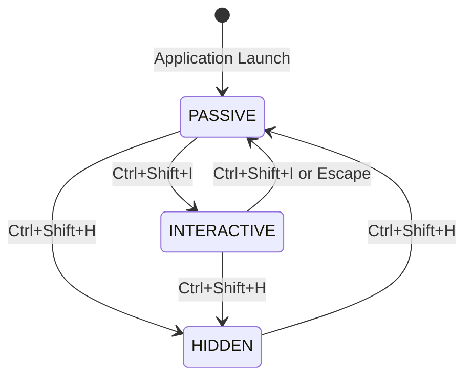

# Desktop Copilot — User & Operation Guide

Desktop Copilot is a local-first, low-latency AI desktop assistant designed for real-time interview assistance, screen reasoning, and voice conversation answering. Built on Electron, React 19, Tailwind CSS v4, and Turborepo, it features a dual-window interface consisting of a top floating HUD and a full-screen transparent "Ghost Overlay".

---

## Table of Contents
1. [Core Features](#core-features)
2. [Quick Start](#quick-start)
3. [The Tri-State Window System](#the-tri-state-window-system)
4. [Keyboard Shortcuts Reference](#keyboard-shortcuts-reference)
5. [Floating HUD Controls](#floating-hud-controls)
6. [Real-Time Interview / Q&A Workflow](#real-time-interview--qa-workflow)
7. [Environment Variables & Model Configuration](#environment-variables--model-configuration)
8. [Session Management & Context Tuning](#session-management--context-tuning)
9. [Audio & Screen Capture System](#audio--screen-capture-system)
10. [Troubleshooting & FAQ](#troubleshooting--faq)

---

## 1. Core Features

- **Full-Screen Transparent Ghost Overlay**: An invisible, click-through overlay that displays streamed AI answers and insights directly on top of your existing IDE, browser, or presentation windows without stealing mouse clicks or keyboard focus.
- **Floating HUD Pill**: A sleek, draggable, always-on-top pill at the top of your screen showing live status indicators, session context, quick toggles, and test triggers.
- **Tri-State Interaction Modes**: Seamless switching between click-through transparency (`PASSIVE`), interactive selection/dismissal (`INTERACTIVE`), and instant privacy hiding (`HIDDEN`).
- **Capability-Based AI Streaming**: Decoupled AI architecture with zero hardcoded model names. Switch dynamically between OpenAI, Google Gemini, Anthropic Claude, Deepgram, or local mock engines.
- **Dual-Audio & Screen Capture**: Capture microphone + system loopback audio simultaneously while grabbing display frames via Direct3D/DXGI on Windows.
- **Local-First Session Storage**: Ephemeral and persistent conversation history stored in local JSON/SQLite with no mandatory external database dependencies.

---

## 2. Quick Start

### Prerequisites
- Node.js `>= 22`
- pnpm `10.12.1+`
- Windows 10/11 (Primary target for DXGI capture and loopback audio)

### 1. Configure Environment
Copy the example environment configuration into `.env`:
```powershell
cp .env.example .env
```
*(By default, `.env` runs in offline **Mock Mode** requiring zero API keys. To connect live cloud models, enter your `OPENAI_API_KEY`, `GEMINI_API_KEY`, or `ANTHROPIC_API_KEY`.)*

### 2. Launch the Application

#### Production / Standard Mode
To run using the pre-compiled overlay bundle:
```powershell
pnpm --filter @repo/desktop start
```

#### Live Development Mode (with React HMR)
To modify React components with live hot-module reloading:
```powershell
# Terminal 1: Run Vite React overlay server
pnpm --filter @repo/overlay dev

# Terminal 2: Run Electron (auto-connects to http://localhost:5173)
pnpm --filter @repo/desktop start
```

---

## 3. The Tri-State Window System

The ghost overlay operates across three operational states designed for stealth, usability, and privacy:



| Mode | Windows Behavior | Mouse & Focus Interaction | Visual Appearance |
| :--- | :--- | :--- | :--- |
| **`PASSIVE`** *(Default)* | Visible & Click-Through | `setIgnoreMouseEvents(true, { forward: true })`<br>Clicks pass through directly to background apps. Cannot steal focus. | Glowing semi-transparent response card with badge indicator. |
| **`INTERACTIVE`** | Visible & Active | `setIgnoreMouseEvents(false)`<br>Interactive mouse control. Enables selecting text, clicking Copy, or dismissing cards. | Interactive border with top action controls ("Copy Answer", "Dismiss"). |
| **`HIDDEN`** | Hidden (Panic Mode) | Completely hidden from screen and taskbar. | Invisible. Background applications have 100% normal interaction. |

---

## 4. Keyboard Shortcuts Reference

Global shortcuts work system-wide even when background applications (e.g., Zoom, Teams, Chrome, VS Code) are focused:

| Global Shortcut | Action | Description |
| :--- | :--- | :--- |
| <kbd>Ctrl</kbd> + <kbd>Shift</kbd> + <kbd>T</kbd> | **Trigger Demo Question** | Sends a test distributed-systems question into the active session and streams the answer onto the Ghost Overlay in real-time. |
| <kbd>Ctrl</kbd> + <kbd>Shift</kbd> + <kbd>I</kbd> | **Toggle Interactive Mode** | Switches the overlay between click-through (`PASSIVE`) and interactive (`INTERACTIVE`) mode to enable text selection or copying. |
| <kbd>Ctrl</kbd> + <kbd>Shift</kbd> + <kbd>H</kbd> | **Panic / Privacy Hide** | Instantly hides the overlay from your screen. Press again to restore. |
| <kbd>Esc</kbd> | **Exit Interactive Mode** | *(When in Interactive Mode)* Returns overlay back to click-through Passive mode. |

> [!NOTE]
> All hotkeys can be customized via `.env` using `HOTKEY_PRIVACY_TOGGLE`, `HOTKEY_INTERACTIVE_TOGGLE`, and `HOTKEY_DEMO_TRIGGER`.

---

## 5. Floating HUD Controls

The Floating HUD is located at the top center of your display:

- **Mode Badge (`Live Passive` / `Interactive`)**: Displays current overlay state. Clicking it toggles between Passive and Interactive modes.
- **Microphone Switch (`Mic: ON/OFF`)**: Enables or disables microphone audio recording and speech-to-text chunking.
- **Screen Capture Switch (`Screen: ON/OFF`)**: Controls background screen frame acquisition.
- **Session Context Button (`Architect`)**: Opens the modal dialog to view and update the active AI persona and conversation instructions.
- **⚡ Demo Q&A Button**: Triggers an immediate question stream onto the screen for testing.

---

## 6. Real-Time Interview / Q&A Workflow

1. **Audio Ingestion**:
   - Audio is captured through dual streams: your microphone (`USER`) and desktop system loopback (`REMOTE_SPEAKER`).
   - The [VadChunker](file:///d:/PROJECTS/__self/desktop-copilot/packages/capture/src/audio/vad-chunker.ts) buffers audio until speech pauses (energy threshold drop), then routes to Speech-to-Text.
2. **Intent Detection**:
   - When a transcript chunk from `REMOTE_SPEAKER` is received, [isQuestionIntent()](file:///d:/PROJECTS/__self/desktop-copilot/packages/core/src/intents/intent-detector.ts) evaluates whether the remote party asked a technical question.
3. **Context Assembly**:
   - [SessionManager](file:///d:/PROJECTS/__self/desktop-copilot/packages/core/src/context/session-manager.ts) gathers the candidate persona, custom guidelines, recent transcript history, and the latest screen frame.
4. **Streaming to Ghost Overlay**:
   - [ConfigurableChatStreamingService](file:///d:/PROJECTS/__self/desktop-copilot/packages/ai/src/capabilities/chat-streaming.ts) streams tokens via IPC to the Ghost Overlay.
   - Text appears letter-by-letter with a typewriter effect directly on your screen.

---

## 7. Environment Variables & Model Configuration

Edit `.env` in the root directory to select your preferred AI providers:

```env
# UI Server URL
RENDERER_URL=http://localhost:5173

# API Keys (Provide one or more)
OPENAI_API_KEY=sk-...
GEMINI_API_KEY=AIzaSy...
ANTHROPIC_API_KEY=sk-ant-...
DEEPGRAM_API_KEY=...

# Chat Model Capabilities
AI_CHAT_PROVIDER=openai           # 'openai' | 'gemini' | 'anthropic' | 'mock'
AI_CHAT_MODEL=gpt-4o              # Any model name (e.g. gpt-4o, gemini-2.0-flash, claude-3-7-sonnet)
AI_CHAT_TEMPERATURE=0.7

# Vision Model Capabilities
AI_VISION_PROVIDER=gemini
AI_VISION_MODEL=gemini-2.0-flash

# Speech-to-Text Capabilities
AI_STT_PROVIDER=deepgram
AI_STT_MODEL=nova-2
```

---

## 8. Session Management & Context Tuning

Sessions manage the behavioral parameters of the AI assistant:

```typescript
const session = await sessionManager.createSession({
  roleOrPersona: 'Senior Distributed Systems Architect',
  instructions: 'Keep responses concise with structured bullet points and high-level trade-offs',
  metadata: { targetCompany: 'Tech Corp', interviewType: 'System Design' }
});
```

To modify active session parameters during an interview:
1. Click the **Context Badge** on the Floating HUD.
2. Edit the **Persona / Role** and **System Instructions** in the modal.
3. Click **"Save Context"**. Subsequent answers will automatically reflect the updated guidelines.

---

## 9. Audio & Screen Capture System

### Windows Capture Adapter
- Uses the [WindowsCaptureAdapter](file:///d:/PROJECTS/__self/desktop-copilot/packages/capture/src/windows/windows-capture-adapter.ts) implementing [CaptureAdapter](file:///d:/PROJECTS/__self/desktop-copilot/packages/capture/src/adapter.ts).
- Frame capture: 1920x1080 @ 1 FPS standard (configurable) to balance image fidelity with API token consumption.
- Audio capture: 16 kHz 16-bit PCM mono stream with voice activity detection.

---

## 10. Troubleshooting & FAQ

#### Q: How do I close or dismiss an answer on screen?
Press <kbd>Ctrl</kbd> + <kbd>Shift</kbd> + <kbd>I</kbd> to enter Interactive Mode, then click **"Dismiss"** in the top-right corner of the response card (or press <kbd>Ctrl</kbd> + <kbd>Shift</kbd> + <kbd>H</kbd> to hide).

#### Q: Why do I see "Unable to move the cache: Access is denied. (0x5)"?
This happens if two Electron processes are running simultaneously. The application includes a single-instance lock that resolves this automatically. If an old process was left open, run:
```powershell
Stop-Process -Name electron -Force -ErrorAction SilentlyContinue
```

#### Q: Can I run this offline without internet or API keys?
Yes. Leaving `.env` API keys blank causes the app to default to `mock` mode. It generates simulated streaming responses for testing overlay rendering and hotkeys with zero network calls.
