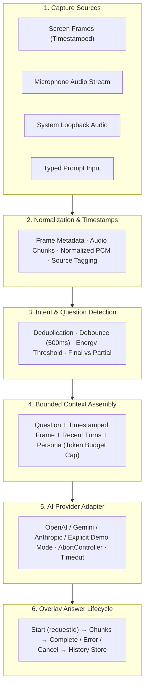
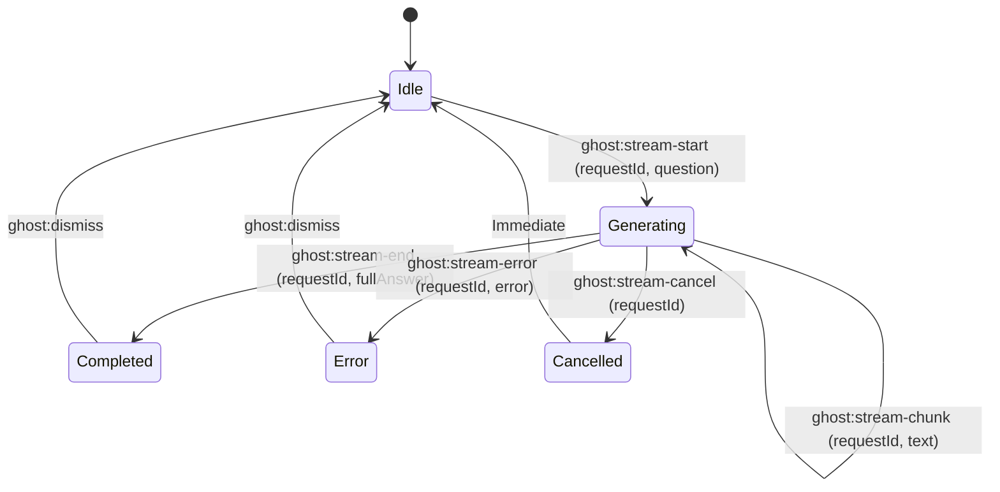

# Production Desktop Copilot Engine Specification

**Date:** 2026-10-18  
**Topic:** End-to-End Production Copilot Pipeline, Native Screen & Dual-Audio Orchestration, Real Streaming AI Providers, and Ghost Overlay Lifecycle  
**Status:** Approved for Implementation Planning  

---

## 1. Executive Summary & Architecture Philosophy

Desktop Copilot is a local-first, low-latency AI desktop assistant designed for real-time interview assistance, screen reasoning, and voice conversation answering. 

Unlike naive prototypes that couple user interface components directly to mock APIs or ad-hoc timers, this production architecture establishes a **strict, event-driven orchestration pipeline** as the single source of truth. Every question, audio chunk, screen frame, and token stream conforms to explicit lifecycle contracts with deterministic cancellation, deduplication, and error recovery.

---

## 2. Core Orchestration Pipeline: The Application Contract

The core orchestration engine in `@repo/core` governs all data flow through six sequential, contract-bound stages:



### Essential Orchestration Rules
1. **Unique Request & Session Identifiers**: Every query has a globally unique `requestId` and belongs to an active `sessionId`.
2. **Deterministic Preemption**: If a new question is detected while an earlier answer is still generating, the in-flight `requestId` is immediately aborted via `AbortController`, preventing stale tokens from corrupting the overlay.
3. **No Partial-Transcript Triggering**: Questions are only detected from **final transcripts** or debounced pause boundaries. Transcripts marked `isFinal: false` update the HUD live ticker but NEVER spawn LLM generation.
4. **Timestamped Visual-Temporal Association**: Screen frames are tagged with capture timestamps (`capturedAt`), allowing the engine to pair questions with what was visible at that exact instant.
5. **Strict Token Budgeting**: Conversation transcripts and OCR/vision context are hard-capped (e.g., 4,000 tokens) using rolling-window truncation to prevent context blowup, unbounded latency, and excessive API costs.
6. **Explicit Failure & Mock States**: If API keys are missing or a network request fails, the system transitions to an explicit `error` state. Offline mock responses are labeled prominently as **Demo Mode** and require explicit user opt-in.

---

## 3. Technical Corrections & Solutions

### Correction 1: Real Screen Capture & Vision
- **Problem**: Electron's `desktopCapturer.getSources()` can return arbitrary thumbnail resolutions, and calling it improperly in main process threads can block IPC.
- **Solution**:
  - Main process coordinates screen frame acquisition via validated IPC using a dedicated screen grabber utility.
  - Image buffers are validated for non-zero dimensions and format (JPEG/PNG).
  - Images are compressed to optimized dimensions (e.g., 1080p @ 80% JPEG quality) and base64 encoded for multimodal input to Gemini 2.0 Flash or GPT-4o Vision.
  - Periodic polling is replaced with **event-driven capture**: snapshot on demand when a question arises, or on a configurable low-frequency timer (e.g., 0.5 FPS) when visual tracking is enabled.

### Correction 2: Strict Separation of Microphone and System Audio
- **Problem**: Microphone audio and desktop loopback audio have completely different capture permissions, latency characteristics, and failure modes. Mixing them blindly leads to severe echo and duplicate transcriptions.
- **Solution**:
  - Keep two distinct audio pipelines:
    - **`MICROPHONE` stream**: Captured via `navigator.mediaDevices.getUserMedia({ audio: true })`.
    - **`SYSTEM_LOOPBACK` stream**: Captured via Electron's desktop capturer loopback audio stream or dedicated WASAPI loopback adapter.
  - Ingestion tags every audio chunk with its explicit source (`USER` vs `REMOTE_SPEAKER`).
  - Only `REMOTE_SPEAKER` transcripts trigger automatic interviewer question answering; `USER` transcripts update conversation context to keep track of the candidate's responses.

### Correction 3: Low-Latency Streaming Speech-to-Text
- **Problem**: Standard Whisper REST endpoints require multipart file uploads and introduce 2–5s latency, making real-time interview assistance impossible.
- **Solution**:
  - Primary path: Persistent WebSocket streaming client (e.g., Deepgram Nova-2 streaming WebSocket API or live PCM chunking).
  - Emits real-time stream events distinguishing `{ isFinal: false, text }` (partial) from `{ isFinal: true, text }` (final).
  - Fallback: High-efficiency chunked VAD (Voice Activity Detection) batcher with documented latency budgets for non-WebSocket providers.

### Correction 4: Transparent Error & Demo State Presentation
- **Problem**: Silently falling back to canned mock text creates false confidence and confusing hallucinations.
- **Solution**:
  - The Floating HUD and Ghost Overlay feature an unambiguous status indicator:
    - 🟢 `LIVE: OpenAI (gpt-4o)` or `LIVE: Gemini (2.0-flash)`
    - 🟡 `DEMO MODE (Simulated Output)`
    - 🔴 `ERROR: Provider Timeout / Missing API Key`
  - If a live call fails, the overlay displays the explicit error message with a single-click action: `[Switch to Demo Mode]` or `[Retry]`.

---

## 4. Multi-Provider AI Architecture (`@repo/ai`)

All AI interactions adhere to a unified `AIProviderAdapter` interface with typed events:

```typescript
export type AIStreamEvent =
  | { type: 'start'; requestId: string; model: string }
  | { type: 'text-delta'; requestId: string; text: string }
  | { type: 'error'; requestId: string; error: { code: string; message: string } }
  | { type: 'complete'; requestId: string; usage?: { promptTokens: number; completionTokens: number } };

export interface AIProviderAdapter {
  readonly id: string;
  readonly supportsVision: boolean;
  streamAnswer(
    payload: ContextPayload,
    question: string,
    options: { signal: AbortSignal; timeoutMs?: number }
  ): AsyncIterable<AIStreamEvent>;
}
```

### Provider Clients Implemented via Native Fetch SSE
1. **OpenAI Adapter**:
   - Endpoint: `https://api.openai.com/v1/chat/completions`
   - Supports: GPT-4o, GPT-4o-mini, o3-mini
   - Multi-modal: Injects base64 image into `image_url` block when visual context is attached.
2. **Google Gemini Adapter**:
   - Endpoint: `https://generativelanguage.googleapis.com/v1beta/models/{model}:streamGenerateContent?alt=sse`
   - Supports: Gemini 2.0 Flash, Gemini 1.5 Pro
   - Multi-modal: `inline_data` base64 image parts.
3. **Anthropic Claude Adapter**:
   - Endpoint: `https://api.anthropic.com/v1/messages`
   - Supports: Claude 3.7 Sonnet, Claude 3.5 Haiku
   - Multi-modal: `image/jpeg` base64 blocks.
4. **Offline Demo Engine**:
   - Generates contextual, dynamic interview responses without external network access.
   - Distinctly tags every emitted chunk with `isDemo: true`.

---

## 5. Overlay Answer Lifecycle Protocol

Answers flow from the orchestration engine to the Ghost Overlay through an explicit state machine:



- **`ghost:stream-start`**: Overlay wipes old text, displays clean card with target question header, and initializes typewriter cursor.
- **`ghost:stream-chunk`**: Appends token deltas. If `requestId` does not match the active request, the chunk is discarded.
- **`ghost:stream-end`**: Finalizes markdown rendering, adds "Copy" and "Dismiss" controls, and saves assistant turn to session history.
- **`ghost:stream-error`**: Displays high-visibility error banner with retry options.

---

## 6. High-End UI & UX Design (`@repo/overlay`)

### Floating HUD Pill (`FloatingHud.tsx`)
- **Audio Activity Waveform**: Real-time canvas audio visualizer showing live decibel/energy levels for microphone and loopback audio.
- **Live Transcript Ticker**: Real-time scrolling badge displaying the last recognized speaker and spoken utterance.
- **Silent Quick-Input Bar**: Expandable keyboard input permitting the user to type a question silently and hit <kbd>Enter</kbd>.
- **Session Context Pill**: Modal for editing the target role/persona and custom answering rules.
- **Mode Toggle & Hotkey Triggers**: Instant switching between `PASSIVE`, `INTERACTIVE`, and `HIDDEN`.

### Ghost Overlay (`GhostOverlay.tsx`)
- **Markdown Rendering**: Structured headers, bullet points, bold keywords, and formatted code blocks.
- **Adjustable Card Opacity**: Slider (20% ghost to 100% solid) to adapt to any user screen wallpaper or editor theme.
- **Repositioning Support**: Can be pinned to bottom-center, top-right, or floating center.
- **Zero-Latency Copy**: One-click button in Interactive Mode to copy answer/code directly to clipboard.

---

## 7. Package Responsibilities

| Package | Strict Architectural Responsibility |
| :--- | :--- |
| **`@repo/desktop`** | Electron process lifecycle, window coordination, validated IPC channels, global shortcut registration, secure storage pathing. |
| **`@repo/overlay`** | HUD controls, audio visualizer canvas, live transcript ticker, typed prompt input, Ghost Overlay markdown renderer, opacity slider. |
| **`@repo/capture`** | Screen snapshotting, dual-stream audio capture adapters, PCM normalization, VAD chunking, capture timestamps. |
| **`@repo/ai`** | Multi-provider streaming adapters (OpenAI, Gemini, Anthropic SSE), `AIStreamEvent` protocol, structured errors, cancellation. |
| **`@repo/core`** | Central orchestration pipeline, question detection, deduplication, context packaging, session storage, conversation history. |

---

## 8. Five-Stage Implementation Roadmap

```
Milestone 01: Real Screen → Real AI → Overlay Lifecycle
├── Step 1.1: Core Orchestration Engine & RequestId Lifecycle Contracts
├── Step 1.2: Multi-Provider SSE Streaming Clients (OpenAI, Gemini, Anthropic + Demo Mode)
├── Step 1.3: Real Desktop Screen Grabber via Electron IPC
└── Step 1.4: Ghost Overlay Lifecycle (Start, Chunk, End, Error, Cancel) + Markdown Rendering

Milestone 02: Real Microphone → Live Audio Activity & Transcript
├── Step 2.1: Web Audio API Microphone Stream Ingestion in HUD
├── Step 2.2: Live Waveform Visualizer Canvas in Floating HUD
└── Step 2.3: Streaming STT Pipeline with Partial vs Final Transcripts

Milestone 03: Windows System Audio → Automatic Question Detection
├── Step 3.1: Windows Loopback Audio Channel Separation
├── Step 3.2: Remote Speaker Intent Detection with 500ms Debounce & Deduplication
└── Step 3.3: Silent Quick-Input Bar in HUD for Manual Override

Milestone 04: Context Assembly & Multi-Turn Conversation Memory
├── Step 4.1: Bounded Token Budget Context Builder (Screen + Transcripts + Persona)
├── Step 4.2: Assistant Turn Persistence & Multi-Turn Follow-Up Memory
└── Step 4.3: Session Settings Modal & Configurable Retention

Milestone 05: Visual Polish, Hardening & Verification
├── Step 5.1: Card Opacity Slider & Ergonomic Positioning
├── Step 5.2: Validated IPC Security & Error Boundary Resilience
└── Step 5.3: Full Test Suite, Typecheck, and Packaged App Verification
```
